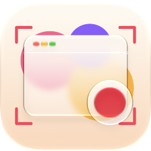

<p align="center">
  
</p>

<h1 align="center">Scope</h1>

<p align="center">A native macOS screen recorder for polished demos and tutorials.</p>

<p align="center">
  <a href="https://github.com/mohitkyadav/scope/releases/latest"></a>
  <a href="https://github.com/mohitkyadav/scope/releases"></a>
  
  <a href="LICENSE"></a>
</p>

---

## Features

| | |
|---|---|
| **Record** | Display or window · mic, system audio, camera · countdown · ⌘⇧2 to stop · 30/60 fps |
| **Zoom** | Auto zoom on clicks and typing · pick the area · per-zoom level, transition and animation · spotlight · motion blur |
| **Cursor** | Smoothed path · real cursor shapes · click ripples · hides when still · glides across cuts |
| **Style** | Gradient or image backgrounds · padding, corners, shadow · webcam bubble |
| **Edit** | Split, delete, 0.25–4× speed · notes · per-track volume · music and voice-over · undo |
| **Export** | MP4 at any size and quality · seamless looping GIFs |

Every recording is a project you can reopen and keep editing, saved to Downloads or a folder you choose.

## Private

Scope never connects to the internet: no analytics, no tracking, no update checks. It runs in Apple's App Sandbox without network access, so it couldn't even if it tried. For zooming on typing it notes when keys are pressed, never which. Check for yourself:

```sh
codesign -d --entitlements - /Applications/Scope.app   # no network.client entitlement
```

## Install

```sh
brew install mohitkyadav/tap/scope
```

Needs macOS 15+. Update with `brew upgrade scope`, remove with `brew uninstall --zap scope`. Recordings are never touched.

Downloading the zip from [Releases](https://github.com/mohitkyadav/scope/releases) instead? Scope isn't notarized, so allow it once in System Settings → Privacy & Security → **Open Anyway**.

## Permissions

| Permission | Needed for |
|---|---|
| Screen & System Audio Recording | Recording (required, reopen Scope after allowing) |
| Microphone | Voice-over (optional) |
| Camera | Webcam bubble (optional) |

## Build

Open `Scope.xcodeproj` in Xcode and run, or:

```sh
xcodebuild -project Scope.xcodeproj -scheme Scope -configuration Release build
```

## License

[MIT](LICENSE)
